<p align="center">
  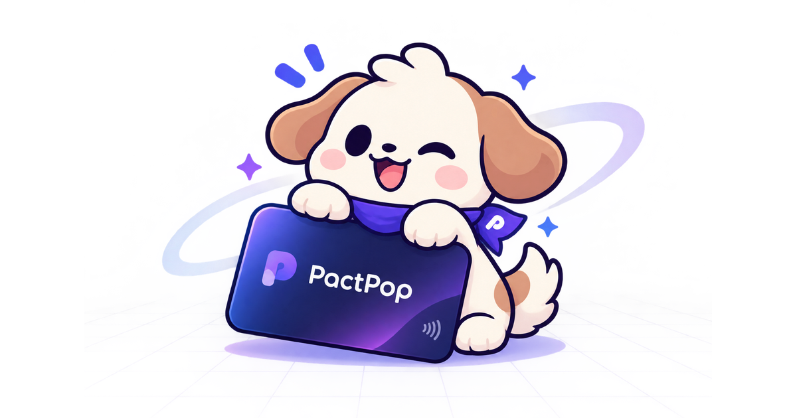
</p>

<h1 align="center">PactPop</h1>

<p align="center"><strong>Make promises. Make progress. Get paid.</strong></p>

<p align="center">
  <a href="https://pact-pop.vercel.app"></a>
  
  
  
  
  
  
  
  
  
</p>

PactPop is an AI-powered commercial operations platform for freelancers, consultants and small agencies. It connects the three stages every client engagement goes through:

1. **Agreement:** what was promised?
2. **Evidence:** was the promised work delivered?
3. **Payment:** is the financial commitment ready to be fulfilled, and has PayPal confirmed it?

Specialised AI agents read client requests, structure scope and pricing, catch scope creep, check delivered work against acceptance criteria, and prepare PayPal invoices. A permission layer called **TrustGate** ensures that sensitive financial actions always wait for a human.

> Built for the **PayPal AI Hackathon** (*Build What's Next with PayPal and AI*). Free and open source under the [MIT License](LICENSE). Runs against the **PayPal Sandbox** only, so no real money moves.

## For judges

| | |
|---|---|
| **Live app** | [pact-pop.vercel.app](https://pact-pop.vercel.app): Log in, then **Try the demo workspace** (no sign-up) |
| **Demo login** | `demo@pactpop.dev` / `pactpop-demo-2026` |
| **PayPal** | Sandbox: OAuth 2.0, Invoicing v2, Orders v2 + Smart Payment Buttons, Webhooks with signature verification |
| **AI** | Groq `openai/gpt-oss-120b` (switchable models), 8 agents, 20 typed tools, TrustGate approvals |
| **5-minute test** | Ask the AI about a scope change, approve the $300 change order, check delivery proof, send a PayPal invoice, then pay a deposit as the client through the one-link checkout (see [Demo walkthrough](#demo-walkthrough)) |

## Screenshots

<table>
  <tr>
    <td width="50%">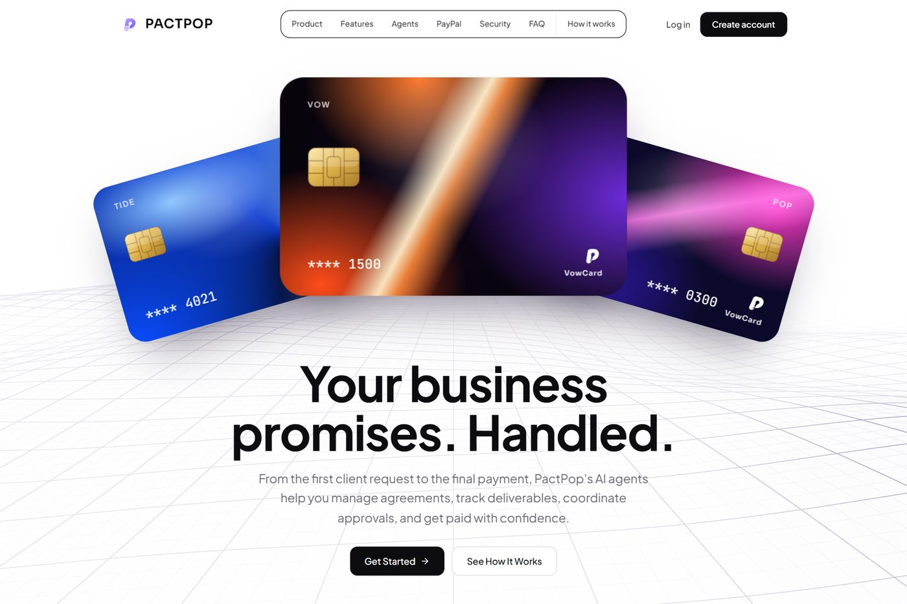<br><sub><b>Landing page</b></sub></td>
    <td width="50%">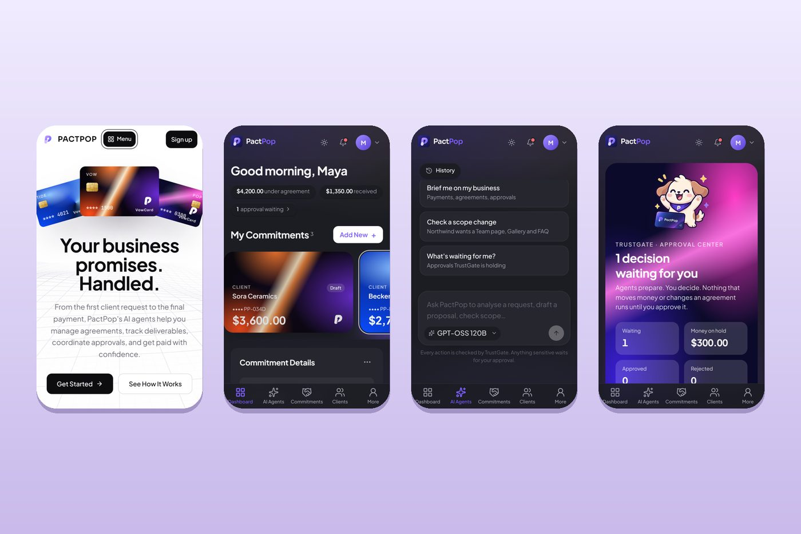<br><sub><b>Phones and tablets</b></sub></td>
  </tr>
  <tr>
    <td>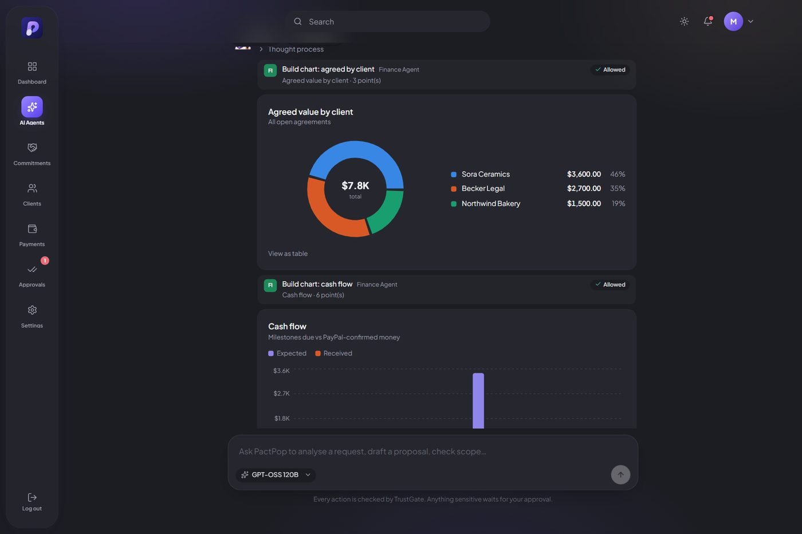<br><sub><b>AI agents</b>: charts built from real data, saved chat history, model picker</sub></td>
    <td>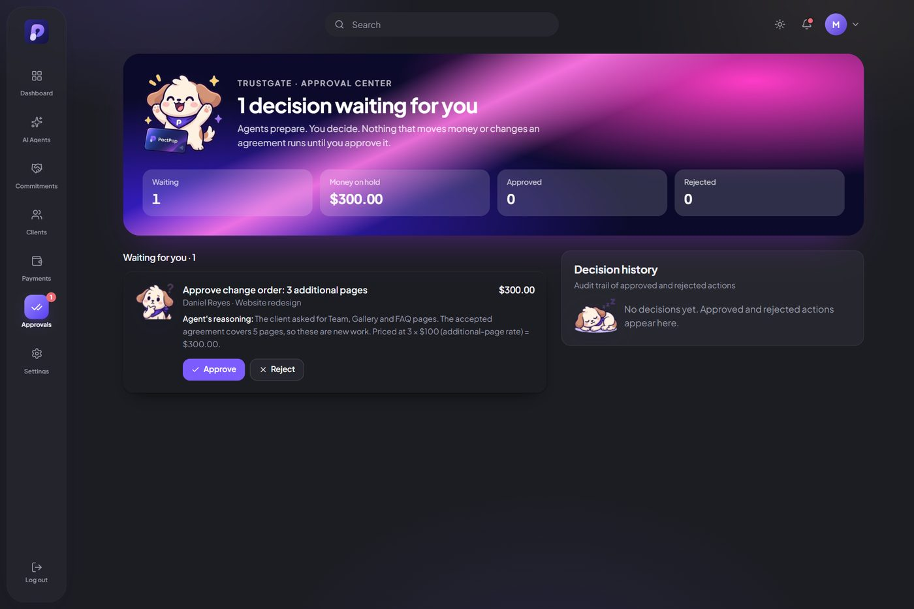<br><sub><b>TrustGate Approval Center</b>: AI prepares, the owner decides</sub></td>
  </tr>
  <tr>
    <td>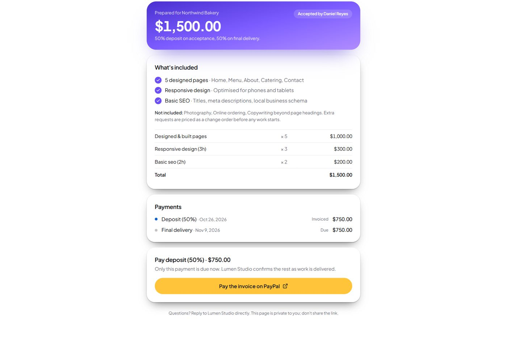<br><sub><b>One-link client checkout</b>: accept the agreement, pay with PayPal</sub></td>
    <td>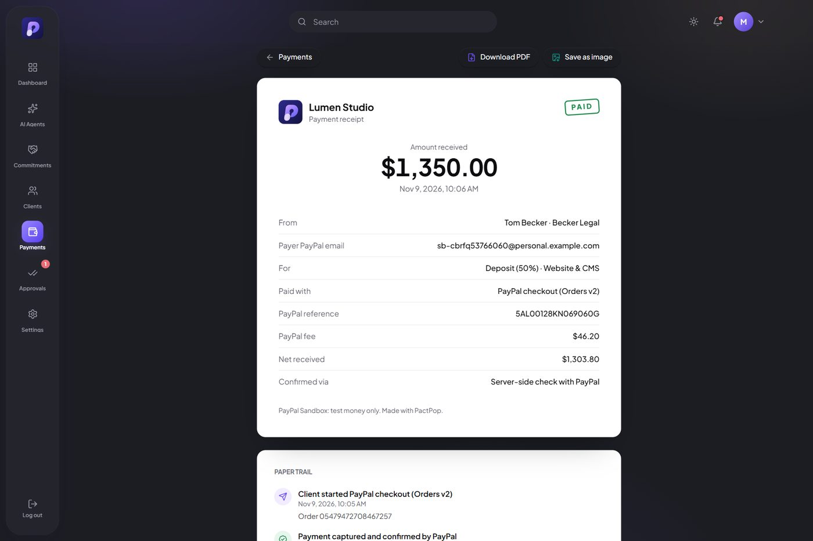<br><sub><b>Documented receipt</b>: PayPal reference, fee and net, paper trail</sub></td>
  </tr>
  <tr>
    <td>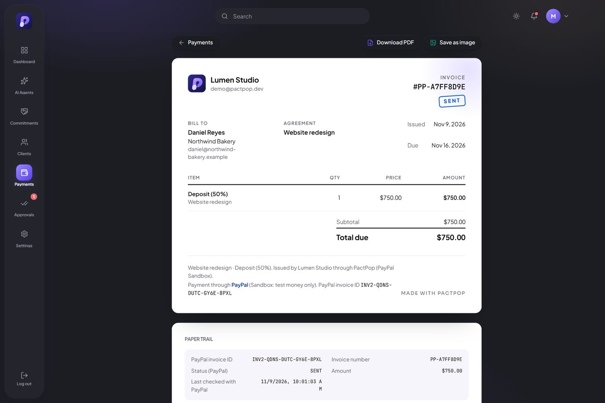<br><sub><b>PayPal invoice</b> with PayPal's own record; PDF or image download</sub></td>
    <td>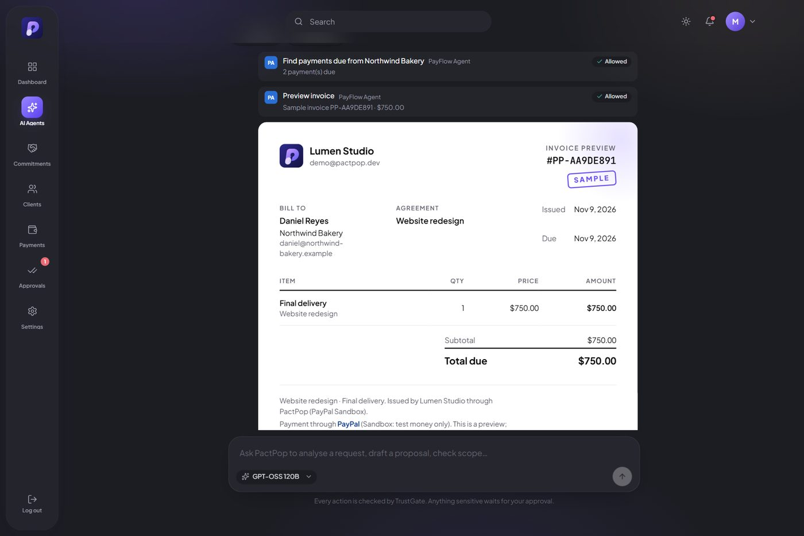<br><sub><b>Invoice samples</b> right in the AI chat</sub></td>
  </tr>
  <tr>
    <td>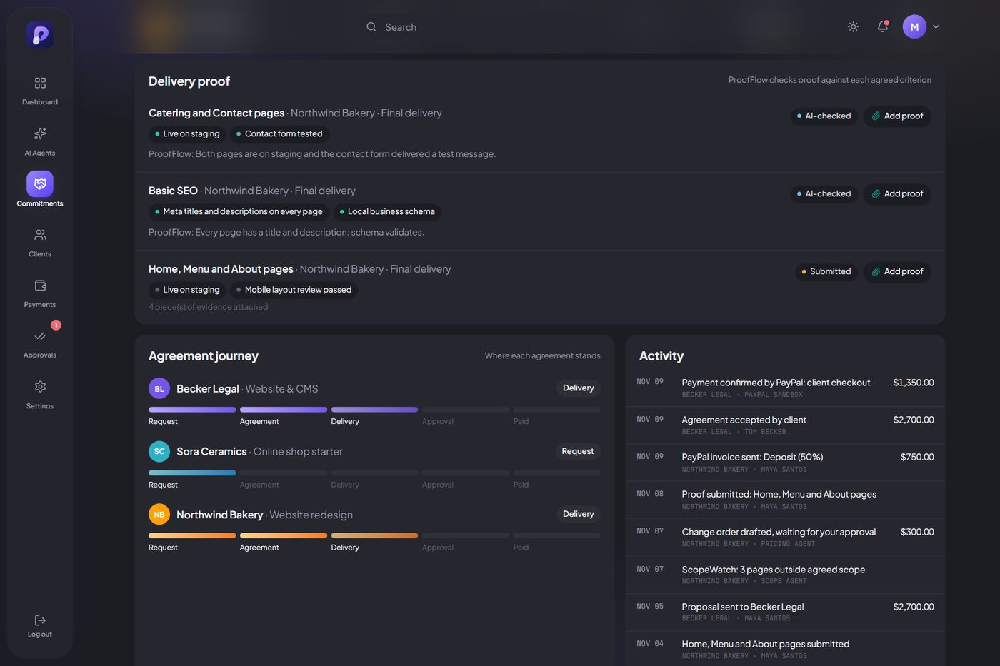<br><sub><b>ProofFlow</b>: delivery proof checked against each acceptance criterion</sub></td>
    <td>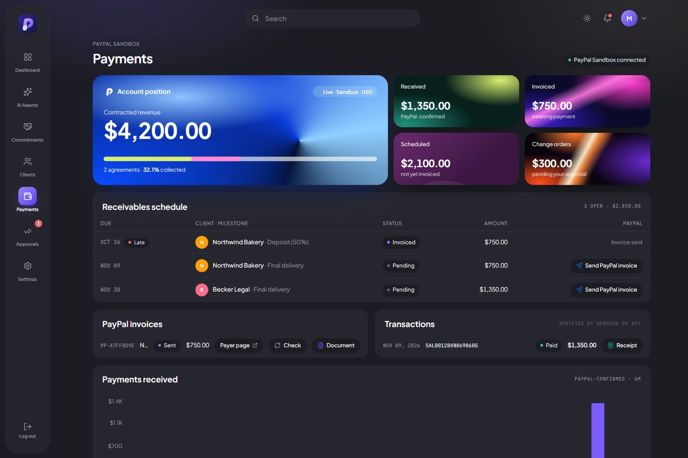<br><sub><b>Payments</b>: only PayPal-confirmed money counts as received</sub></td>
  </tr>
  <tr>
    <td>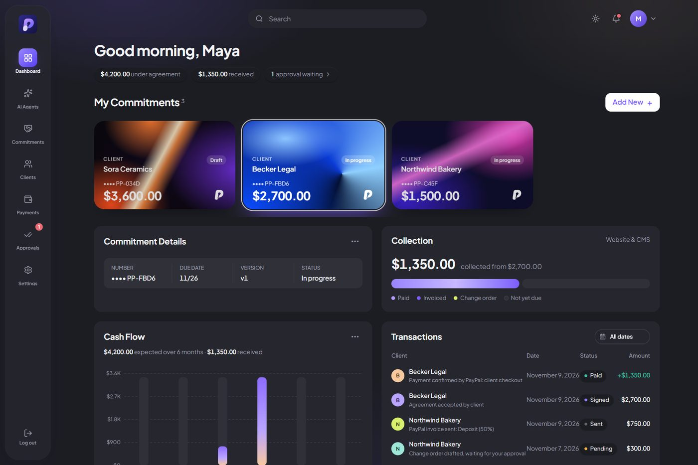<br><sub><b>Dashboard</b>: agreements, cash flow and transactions</sub></td>
    <td>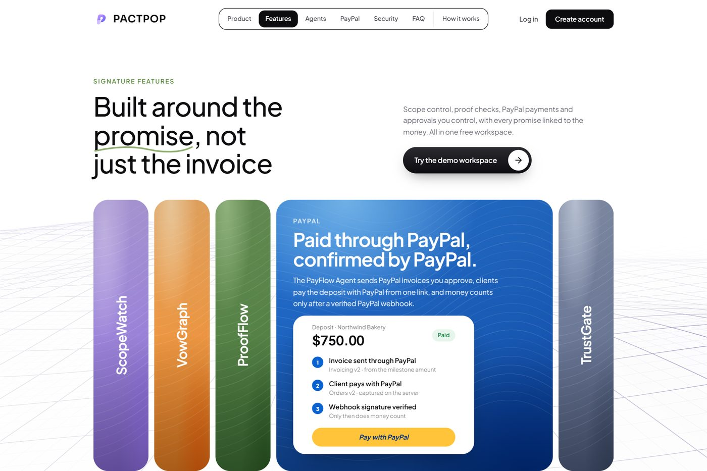<br><sub><b>Signature features</b>: ScopeWatch, VowGraph, ProofFlow, PayPal, TrustGate</sub></td>
  </tr>
</table>

## Architecture

One Next.js application (App Router) deployed on Vercel. Server code (agents, PayPal client, domain services) runs only on the server; the browser never sees credentials or access tokens.

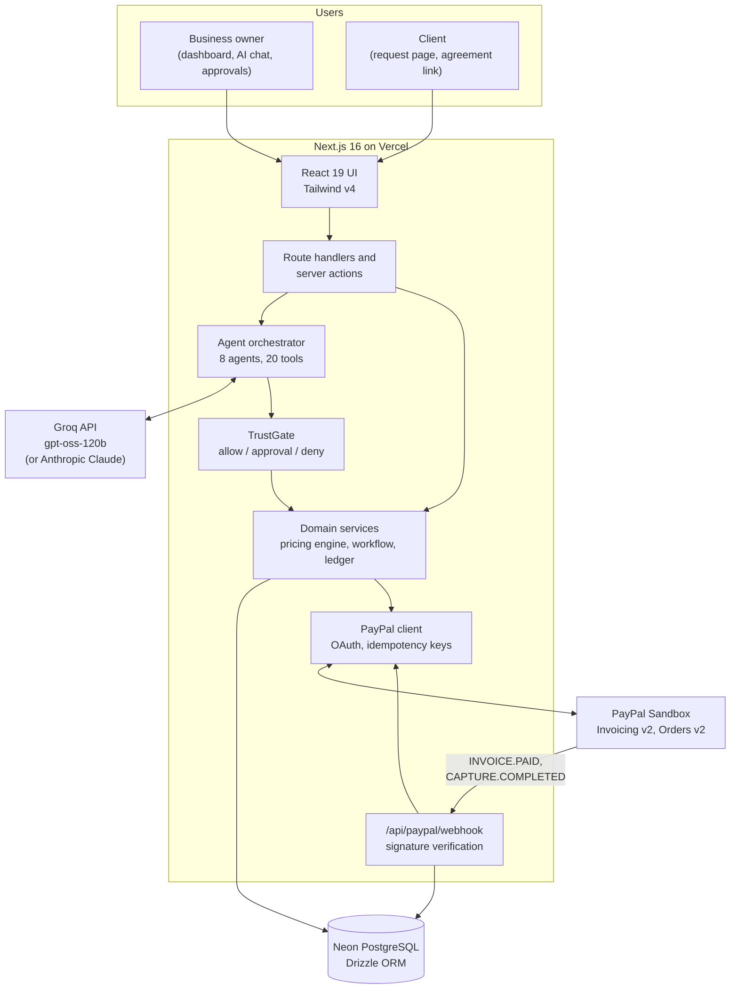

### How a promise becomes a payment

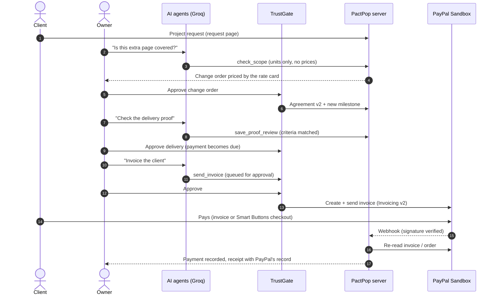

### Design rules

| Rule | Where it is enforced |
|---|---|
| The AI never sets a price. Tools take units (pages, hours); the pricing engine computes money in integer minor units. | `src/server/services/pricing.ts`, `src/server/agents/tools.ts` |
| Every agent tool call is validated (Zod) and permission-checked before it runs. Money actions have locked "approval" floors. | `src/server/agents/orchestrator.ts`, `src/server/agents/policies.ts` |
| Money counts only after PayPal confirms it: verified webhook or server-side re-read, never a browser redirect. | `src/server/paypal/webhooks.ts`, `invoices.ts`, `orders.ts` |
| Every PayPal write is idempotent (`PayPal-Request-Id`); every webhook event is stored once. | `src/server/paypal/` |
| Clients can only pay what is due (deposit, or a delivery the owner approved). | `src/lib/checkout.ts` |
| Every invoice and payment keeps PayPal's own record and a paper trail. | `src/server/services/invoice-docs.ts`, `/app/payments/invoices/[id]`, `/app/payments/receipts/[id]` |

### Frameworks and services

| Layer | Technology |
|---|---|
| Framework | Next.js 16 (App Router, server actions, route handlers), React 19, TypeScript |
| Styling | Tailwind CSS v4, Plus Jakarta Sans, custom iOS-style components |
| Data | PostgreSQL on Neon (production), embedded PGlite (local), Drizzle ORM, SQL migrations |
| Payments | PayPal REST APIs (Sandbox): OAuth 2.0, Invoicing v2, Orders v2, JavaScript SDK Smart Payment Buttons, Webhooks |
| AI | Groq (OpenAI-compatible API, `openai/gpt-oss-120b`, `gpt-oss-20b`, Qwen 3.8 27B); Anthropic Claude as an alternative provider |
| Validation and security | Zod, bcrypt, hashed session tokens, rate limiting, tenant scoping, audit log |
| Charts and documents | Recharts, html-to-image, print stylesheets |
| Graphics | three.js (WebGL landing background), Poppy mascot artwork |
| Testing | Vitest (unit + integration on in-memory Postgres), Playwright (browser and PayPal Sandbox runs) |
| Hosting | Vercel (automatic deploys from GitHub) |

## Demo walkthrough

1. Open [pact-pop.vercel.app](https://pact-pop.vercel.app) and choose **Log in, Try the demo workspace**.
2. **AI Agents:** ask *"Northwind Bakery just asked for an online ordering page and a blog. Is that covered?"* The Scope Agent reads the signed agreement and prices a change order.
3. **Approvals:** approve *"3 additional pages ($300)"*. The agreement becomes version 2 with a new milestone.
4. **AI Agents:** *"Check the delivery proof Northwind Bakery submitted."* Then approve the delivery in Approvals.
5. **AI Agents:** *"Invoice Northwind Bakery for their final delivery."* Approve it; a real PayPal Sandbox invoice is sent. Open it from **Payments, Document**.
6. **Commitments, Becker Legal, Client link, Open:** accept as the client and pay the deposit with the PayPal button (Sandbox buyer account).
7. **Payments, Receipt:** the documented receipt with PayPal's fee and net. Use **Download PDF** or **Save as image**.
8. Optional: ask for *"a donut chart of agreed value by client"* or *"a sample invoice"*; reopen chats from **History**.

---


## Project status

PactPop is under active development. This table is kept honest: anything not marked *Working* is not implemented yet.

| Area | Status |
|---|---|
| Landing, features and how-it-works pages, revenue-leak calculator, product tour | Working |
| Registration / login (session auth), one-click demo login | Working |
| Dashboard (PayPal-confirmed metrics only), clients (list, search, create, edit, balances) | Working |
| Database schema for the whole workflow (24 tables), migrations, demo seed | Working |
| Deterministic pricing engine, exact money handling, TrustGate policy table | Working (unit-tested) |
| Light & dark themes; responsive on phones (iOS/Android) and tablets with a mobile tab bar; scroll-reactive WebGL grid terrain | Working |
| Poppy the pup mascot across the landing page and app (moods for approvals, payments, errors) | Working |
| One-click demo workspace with sample commitments, scope change and approval; **Reset demo data** in Settings | Working |
| **Client request page** behind each business's request link (`/request/[slug]`) | Working |
| **One-link client checkout** (`/agreement/[token]`): client reviews scope, accepts by name, pays the deposit with PayPal Smart Buttons (Orders v2, server-side create + capture) | Working (tested in the Sandbox) |
| **AI Agents** chat page: live, streamed agent runs with every tool call and TrustGate decision visible | Working |
| **Settings**: editable TrustGate permissions (locked money controls), agent history, tools, workspace | Working |
| **Finance dashboard** (account position, cash flow, charts, transactions), **Commitments** (cards/table, delivery proof, agreement journey, activity) and **Payments** pages | Working |
| All 8 agents (Intake, Pricing, Proposal, Scope, Operations, Finance, ProofFlow, PayFlow) acting on real records through 20 tools | Working (Groq `openai/gpt-oss-120b` or Claude, set by `AI_PROVIDER`; labelled rule-based mode without a key) |
| **Approval Center** + inline approvals: approving a change order creates agreement v2 and a change-order milestone | Working |
| Agent briefing: next actions found in your records, one click to run | Working |
| PayPal Sandbox: server-side OAuth, **Invoicing v2** milestone invoices (create + send), payment confirmed with the PayPal API | Working |
| PayPal **webhooks**: signature verified with PayPal, stored once per event id, invoice/capture re-read from PayPal before money is recorded | Working (live on Vercel) |
| **PayFlow Agent**: finds payments due, prepares PayPal invoices (queued in TrustGate for your approval), checks payment status with PayPal | Working |
| **AI chat**: saved conversation history (reopen and continue), model picker, charts the agents can show (pie, donut, bar, line, with numbers from the database), invoice samples | Working |
| **Every PayPal invoice and payment is documented**: printable invoice and receipt pages with PayPal's own record (IDs, status, fee/net, webhooks) and a paper trail; download as PDF or save as image | Working |
| **ProofFlow Agent**: checks delivery proof against each acceptance criterion; a passing review queues "Approve delivery", which makes the payment due | Working |
| Approved ScopeWatch change orders become invoiceable milestones | Working |
| Delivery-proof file uploads (proof is links + notes today), client-facing receipts, email reminders | Planned |

The full plan is in [docs/ARCHITECTURE.md](docs/ARCHITECTURE.md), the agent system is documented in [docs/AGENTS.md](docs/AGENTS.md), and progress is tracked in [docs/DEVLOG.md](docs/DEVLOG.md).

### Hackathon requirements: where each one stands

| Requirement | How PactPop meets it | Status |
|---|---|---|
| Meaningfully integrate a PayPal technology | Invoicing v2 for deposits, milestones and change orders; Orders v2 checkout; verified webhooks drive the commitment timeline | Invoicing v2, Orders v2 checkout and verified webhooks all working in the Sandbox |
| Meaningfully incorporate AI | AI orchestrator (Groq or Claude) coordinating specialist agents through permission-checked tools that change real records ([docs/AGENTS.md](docs/AGENTS.md)) | All 8 agents working: Intake, Scope, Pricing, Proposal, Operations, Finance, ProofFlow and PayFlow |
| Working prototype | Live at [pact-pop.vercel.app](https://pact-pop.vercel.app) with a one-click demo workspace; setup steps below also run locally | Live and tested end to end against the PayPal Sandbox |
| Documentation | This README plus [docs/](docs/) | |
| Public, open-source repo with a license | MIT, see [LICENSE](LICENSE) | |

---

## The problem

Freelancers rarely lose money on the work itself. They lose it **between the steps**: agreements buried in email, small "can you also…" requests that never get priced, and invoices that are created late and chased by hand. Invoicing tools bill for work that was done. They don't protect the revenue that leaks before an invoice exists.

## Why AI is essential

The inputs are unstructured: client emails, change requests, screenshots and delivery notes. AI agents turn them into structured records (requirements, scope differences, verification reports) that ordinary software can then act on safely. PactPop keeps a strict split:

- **The model interprets** text and proposes *units* of work (pages, features, hours).
- **Code decides.** Prices are calculated by the deterministic pricing engine from your rates. Permissions are enforced by TrustGate on the server. Payment status comes only from PayPal.

## How PayPal is integrated

All PayPal calls run on the server against the **PayPal Sandbox** (`src/server/paypal/`):

| PayPal tool | What PactPop does with it |
|---|---|
| **REST API: OAuth 2.0** (client credentials) | Server-side sign-in with token caching; credentials and tokens never reach the browser. |
| **Invoicing API v2** | Creates and sends a PayPal invoice for each milestone (deposit, final payment, approved change orders), with the amount taken from the stored milestone. Status is re-checked with PayPal before any payment is recorded. Used from the Payments page and by the **PayFlow Agent** (after the owner approves). |
| **Orders API v2 + JavaScript SDK (Smart Payment Buttons)** | The client's one-link checkout (`/agreement/[token]`): the client accepts the agreement and pays the deposit with PayPal. The order is created and captured on the server; amount, PayPal fee and net come from PayPal's capture response. |
| **Webhooks + Verify Webhook Signature** | `INVOICING.INVOICE.PAID` and `PAYMENT.CAPTURE.COMPLETED` (endpoint `/api/paypal/webhook`) are signature-verified, stored once per event id, then the invoice/order is re-read from PayPal before money is counted. |
| **Sandbox test accounts** | Business and personal buyer accounts for real end-to-end test payments. |

Every PayPal invoice and payment is **documented**: `/app/payments/invoices/[id]` and `/app/payments/receipts/[id]` show the invoice or receipt with PayPal's own record (IDs, status, fee, net, webhook events) and a paper trail, downloadable as PDF or saved as an image.

- Every mutating call sends a `PayPal-Request-Id` derived from an internal record ID, so retries are idempotent.
- A payment counts as complete **only** after a verified webhook or a server-side status check. A browser redirect is never treated as proof of payment.
- Webhook events are stored with a unique PayPal event ID, so duplicate deliveries are ignored.
- Client secrets and access tokens never reach the browser, and the app refuses to start against non-sandbox PayPal hosts.

## How the agents work

One capable model with eight specialised roles: **Intake, Scope, Pricing, Proposal, Operations, ProofFlow, PayFlow and Finance**. A central orchestrator routes each request. Every tool call passes through **TrustGate**, which returns one of three outcomes:

| Decision | Result |
|---|---|
| `allow` | The tool runs (e.g. reading invoices, drafting a proposal). |
| `approval` | An approval request is created with the AI's reasoning summary. Nothing runs until a human approves it. |
| `deny` | The call is blocked and logged. |

The agents run on **Groq** (`openai/gpt-oss-120b` by default; `gpt-oss-20b` and Qwen 3.8 27B are selectable in the chat), or **Anthropic Claude** with `AI_PROVIDER=anthropic`. They can show charts (pie, donut, bar, line) and invoice samples in the chat, and conversations are saved in a History panel. The model chooses tools and views; every amount and chart value is computed by code from the database.

Capturing payments, issuing refunds, changing agreed amounts, applying change orders and approving deliveries have a **locked floor of "approval"** that no configuration can relax. Tool policies live in [`src/server/agents/policies.ts`](src/server/agents/policies.ts).

---

## Tech stack

- **Next.js 16** (App Router) · **React 19** · **TypeScript** · **Tailwind CSS v4**
- **Drizzle ORM** on **PostgreSQL**, with embedded **PGlite** for zero-setup local development
- **Zod** validation, **bcrypt** password hashing, **Recharts** charts, **three.js** (WebGL background)
- **Vitest** unit tests, **Playwright** browser checks
- **Groq** (OpenAI-compatible API, `openai/gpt-oss-120b`) or **Anthropic Claude** for the agents; **PayPal REST APIs** (Sandbox)
- **Vercel** hosting with **Neon** serverless PostgreSQL in production; **html-to-image** for saving documents as images

Key decisions and their reasons are recorded in [docs/DECISIONS.md](docs/DECISIONS.md).

## Project structure

```
src/
  app/(marketing)/          landing, features, how-it-works
  app/(auth)/               login, register (+ server actions)
  app/app/                  owner app: dashboard, AI agents, commitments, clients,
                            payments (+ invoice and receipt documents), approvals, settings
  app/request/[slug]/       public client request page
  app/agreement/[token]/    client agreement + PayPal checkout (one private link)
  app/api/agents/           streaming agent runs, chat history
  app/api/paypal/webhook/   PayPal webhook receiver (signature verified)
  components/               brand + mascot, ui primitives, app shell, agents chat, documents, marketing
  lib/                      client-safe helpers (money, checkout rule, document types)
  server/
    agents/                 orchestrator (Groq / Claude), 20 tools, TrustGate policies, rule-based planner
    paypal/                 OAuth client, invoices, orders, webhooks
    services/               pricing, workflow, proof (ProofFlow), agreements, charts, documents, finance, demo
    db/                     Drizzle schema, migrations, database factory (Neon / PGlite)
    auth/  security/        sessions and guards, rate limiting
scripts/                    migrate, seed
tests/                      unit (money, pricing, extraction, checkout) + integration (agents on in-memory Postgres)
docs/                       architecture, agents, decisions, dev log, demo script, screenshots
```

---

## Getting started

**Requirements:** Node.js 20.9 or newer, and npm.

```bash
git clone https://github.com/Debb1ie/PactPop.git
cd PactPop
npm install
cp .env.example .env        # add PayPal Sandbox + AI keys here (optional: the app runs without them)
npm run db:seed             # creates the local database and the demo workspace
npm run dev                 # http://localhost:3000
```

With no `DATABASE_URL`, data is stored in an embedded PostgreSQL (PGlite) under `./.data/`. Stop the dev server before running `db:seed` or `db:migrate`, because PGlite allows only one process at a time.

### Demo account

On the login page, click **Try the demo workspace** for one-click access. The demo workspace is created automatically on first use. You can also sign in manually:

- **Email:** `demo@pactpop.dev`
- **Password:** `pactpop-demo-2026`

The demo ("Lumen Studio") contains four clients and:
- the $1,500 Northwind Bakery redesign, in progress
- a ScopeWatch change order for 3 extra pages ($300), waiting in the approval queue
- a proposal sent to Becker Legal
- a brand-new request from Kitefly Tours
- a draft commitment

`npm run db:seed` resets it to this state. Seeded records are tagged **DEMO**. **No invoices or payments are seeded**, so "Payments received" stays at $0 until a real PayPal Sandbox payment is made.

### Environment variables

See [`.env.example`](.env.example) for the documented list:

| Variable | Purpose |
|---|---|
| `APP_URL` | Public base URL (PayPal return URLs) |
| `DATABASE_URL` | Empty → PGlite; `postgres://…` → PostgreSQL |
| `PAYPAL_CLIENT_ID` / `PAYPAL_CLIENT_SECRET` | PayPal **Sandbox** REST app credentials |
| `PAYPAL_BASE_URL` | Must be `https://api-m.sandbox.paypal.com` |
| `PAYPAL_WEBHOOK_ID` | Webhook ID used for signature verification |
| `AI_PROVIDER` / `AI_API_KEY` / `AI_MODEL` | Agent model configuration (`heuristic` = clearly labelled rule-based mode) |

**Never commit `.env` or real credentials.** It's already in `.gitignore`.

### PayPal Sandbox setup

1. Sign in at [developer.paypal.com](https://developer.paypal.com) and open **Apps & Credentials → Sandbox**.
2. Create a REST app, then copy its Client ID and Secret into `.env`.
3. Under **Testing Tools → Sandbox Accounts**, use the generated *personal* account to pay invoices as a test customer.
4. Webhooks need a public URL. Expose your local server with a tunnel (e.g. `cloudflared tunnel --url http://localhost:3000`), then register `<public-url>/api/paypal/webhook` in the app's webhook settings and copy the webhook ID into `PAYPAL_WEBHOOK_ID`.

Without PayPal keys the app still runs; PayPal actions are disabled and the UI says PayPal isn't connected.

### AI setup

Create a free key at [console.groq.com](https://console.groq.com) and set `AI_PROVIDER=groq` and `AI_API_KEY` in `.env` (default model `openai/gpt-oss-120b`). Without a key, the agents run in a clearly labelled rule-based mode with the same tools and TrustGate checks.

### Deployment (as used for the live demo)

1. Create a **Neon** Postgres database and copy its pooled connection string.
2. Import the GitHub repo into **Vercel** and add the environment variables from `.env.example` (`DATABASE_URL` = Neon string, `APP_URL` = your Vercel URL).
3. Run `npm run db:migrate` once against the Neon database.
4. Register the PayPal webhook at `<APP_URL>/api/paypal/webhook` and set `PAYPAL_WEBHOOK_ID`.

Every push to `main` redeploys automatically.

## Scripts

| Command | What it does |
|---|---|
| `npm run dev` | Start the dev server |
| `npm run build` / `npm start` | Production build / serve |
| `npm test` | Run unit tests (Vitest) |
| `npm run typecheck` | Generate route types and run `tsc` |
| `npm run lint` | ESLint |
| `npm run db:generate` | Generate a migration from schema changes |
| `npm run db:migrate` | Apply migrations |
| `npm run db:seed` | Migrate and (re)create the demo workspace |

## Testing

```bash
npm test            # money formatting and the pricing engine
npm run typecheck
npm run lint
npm run build
```

The tests check, among other things, that the demo project prices to **$1,500** with a **$750** deposit, that three extra pages price to a **$300** change order, that money never goes through floating-point maths, and that unknown features are flagged instead of priced by guesswork.

## Security notes

- Passwords are hashed with bcrypt, and session tokens are random and stored only as SHA-256 hashes in an httpOnly cookie.
- Every query is scoped to the signed-in user's business, and membership is re-checked on every request.
- Login and registration are rate-limited. Login errors don't reveal whether an account exists.
- Security headers are set: `X-Frame-Options`, `nosniff`, `Referrer-Policy` and `Permissions-Policy`.
- The rate limiter is in-memory, one instance per server. Multi-instance deployments need a shared store.

## Known limitations

- PayPal runs in **Sandbox only** by design; the app refuses to start against live PayPal hosts.
- Delivery proof is notes and links; file uploads are planned.
- Groq's free tier rate-limits long multi-step agent runs; the orchestrator waits and retries automatically.
- In rule-based mode (no `AI_API_KEY`) the planner understands a fixed set of intents. The AI provider (Groq or Claude) handles free-form requests.
- PGlite is for local development only. Use PostgreSQL in production.

## Disclaimer

PayPal is a trademark of PayPal, Inc. PactPop is an independent hackathon project and is not affiliated with or endorsed by PayPal. PactPop helps organise agreements and evidence. It does not provide legal advice or guarantee payment outcomes.

## Tools used

| Tool | How it is used |
|---|---|
| **PayPal Developer Platform (Sandbox)** | Invoicing v2, Orders v2 and Webhooks are the payment backbone: deposits, milestone payments and approved change orders are invoiced through PayPal, and only PayPal-verified events mark money as received. |
| **Groq** (runtime, `openai/gpt-oss-120b`) | Default AI provider for PactPop's agents, used through Groq's OpenAI-compatible chat API with tool calling. Free tier; the orchestrator waits and retries when Groq's rate limit asks it to. |
| **Anthropic Claude** (runtime, optional, `claude-opus-5-5`) | Alternative provider (`AI_PROVIDER=anthropic`). Powers PactPop's agents: extracting requirements from client messages, comparing new requests with the accepted scope, drafting proposals and change orders, and checking deliverable evidence. Accessed through a provider interface, so the model can be swapped. Every tool call goes through TrustGate. |
| **Claude Code** (development) | AI coding assistant used to plan the architecture, write and review code, and run tests and browser checks during the hackathon. It is not part of the running app. |
| **Mascot artwork (Poppy the pup)** | Sticker set and hero illustration supplied by the project owner; cut into transparent stickers for the app (`public/mascot/`). |
| **Vercel** | Hosts the live app (`pact-pop.vercel.app`); every push to GitHub deploys automatically. |
| **Neon** | Serverless PostgreSQL for production data (agreements, invoices, payments, chat history). |
| **Recharts** | Dashboard and AI-chat charts. |
| **html-to-image** | "Save as image" for invoices and receipts. |
| **three.js** | WebGL grid-terrain background on the landing page that reacts to scrolling. |

## License

PactPop is free and open source under the [MIT License](LICENSE). There are no paid plans.
